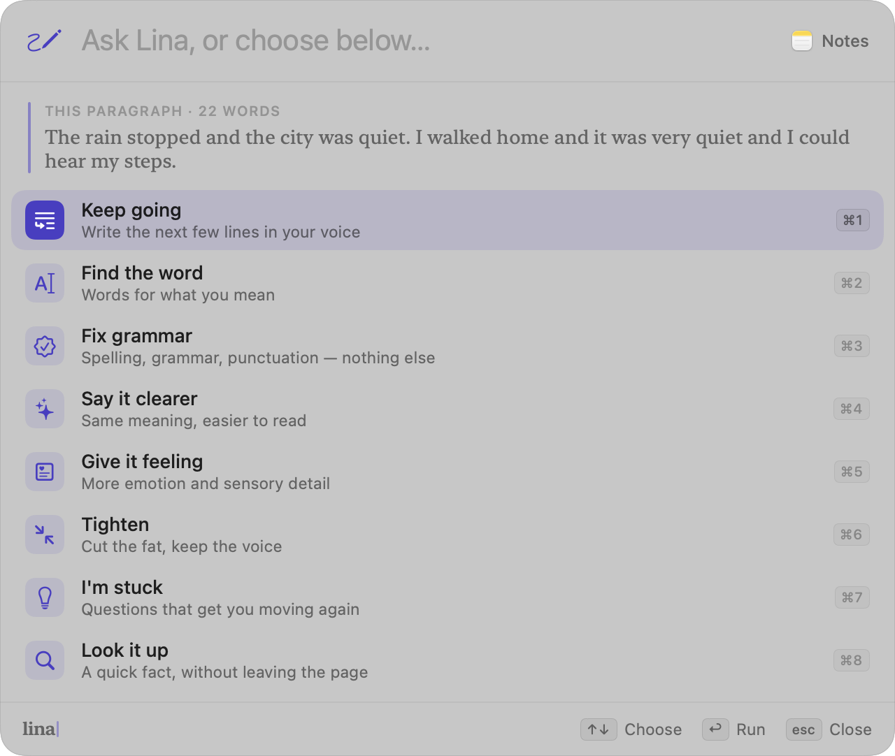

<p align="center"></p>

<h1 align="center">Lina</h1>
<p align="center"><em>Write with someone beside you.</em></p>

Lina is an open-source macOS writing companion. It reads along in **any app** — Notes, Mail, Journal, Safari, Obsidian — and when you pause, offers what might come next as faint ink right at your cursor. Press **Tab** to keep it, or just keep typing.

It runs on open models: **NVIDIA Nemotron on Nebius Token Factory** by default, or any model on your own Mac (Ollama, LM Studio, llama.cpp) for complete privacy.

<p align="center"></p>

## What it does

| | |
|---|---|
| **Ghost text, everywhere** | A context-aware continuation appears at the caret in any app after a natural pause — never mid-word. `⇥` keeps it, `⌥⇥` keeps one word, `esc` or typing dismisses. Type along with it and the rest stays. |
| **Ask Lina (`⌥ Space`)** | A Spotlight-style palette: **Keep going**, **Find the word**, **Fix grammar**, **Say it clearer**, **Give it feeling**, **Tighten**, **I'm stuck**, **Look it up**, or type any instruction. Works on your selection, or the paragraph you're in. `↩` replaces, `⌘↩` inserts after. |
| **The Desk** | A calm, serif writing space with true inline ghost text, typewriter scrolling and a focus mode that dims everything but the current paragraph. Pages are plain Markdown files. |
| **Your voice** | Pick Journal, Essay, Research, Story or Work, and tell Lina a little about how you write. |
| **A daily rhythm** | A word goal, a progress ring and a streak in the menu bar — all stored only on your Mac. |
| **Private by design** | Never reads password fields or secure input. Turn Lina off per app. No account, no analytics. Choose “On this Mac” and nothing leaves your machine. |

<p align="center">
  
</p>
<p align="center">
  
  
</p>

## Install

Requirements: macOS 14+, Apple Silicon, Xcode 16+ command line tools.

```sh
git clone https://github.com/<you>/lina && cd lina
scripts/build-app.sh --open      # builds build/Lina.app and launches it
```

Move `build/Lina.app` to `/Applications` to keep it. On first launch Lina walks you through:

1. **Accessibility access**: so Lina can read the field you're typing in and find your cursor (System Settings → Privacy & Security → Accessibility).
2. **A model**:
   - **Nebius Token Factory**: paste an API key from [tokenfactory.nebius.com](https://tokenfactory.nebius.com). Default model: `nvidia/NVIDIA-Nemotron-3-Nano-30B-A3B`. Use the refresh button in Settings → Model to choose another Nemotron model.
   - **On this Mac**: `ollama serve` and `ollama pull llama3.2` (or any model). Point Lina at `http://localhost:11434/v1`.
3. **Your voice and daily goal.**

> After rebuilding, macOS may ask you to grant Accessibility again, because the ad-hoc signature changes.

## Check a model from the terminal

```sh
swift build
LINA_NEBIUS_API_KEY=… .build/debug/Lina --selftest          # Nebius / Nemotron
.build/debug/Lina --selftest --local llama3.2                # local Ollama model
```

This runs the real prompts (ghost text, find the word, fix grammar) and prints the results and latency.

## How it works

```
Sources/Lina
├── App/        LinaApp (menu bar + windows), self-test, snapshot renderer
├── Core/       Accessibility reader, event tap & text insertion, hotkey,
│               streaming OpenAI-compatible client, prompts, settings, stats
├── Engine/     GhostEngine (system-wide suggestions), PaletteController, targets
├── Desk/       DeskTextView (inline ghost, typewriter, focus), page store
├── UI/         Ghost panel, palette, menu bar, settings, onboarding
└── Design/     Theme: ink, paper, New York serif, keycaps
```

- **Reading.** `AXUIElement` gives the focused field's text, selection and caret bounds (`kAXBoundsForRangeParameterizedAttribute`). Secure fields, secure input and turned-off apps are skipped.
- **Timing.** A `CGEventTap` watches keystrokes. It swallows Tab and Esc **only** while a suggestion is on screen. After your pause setting (550 ms by default), and only after a finished word or comma, Lina asks the model.
- **Thinking.** Requests stream from any OpenAI-compatible `/chat/completions` endpoint. Nemotron's reasoning is turned off (`/no_think`, `enable_thinking: false`) and any `<think>` spans are filtered out of the stream, so suggestions arrive fast. Typing cancels the request in flight.
- **Showing.** A click-through, non-activating `NSPanel` draws the ghost at the caret and follows it as you type. Accepted text is typed in as keyboard events, so it lands in the app's own undo stack. Palette rewrites are pasted in, and your clipboard is put back afterwards.

## Develop

```sh
swift test                                   # unit tests
.build/debug/Lina --snapshots build/snapshots   # render every screen, light + dark
```

## License

MIT. See [LICENSE](LICENSE).
