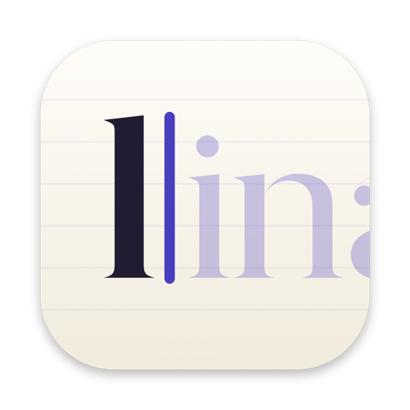
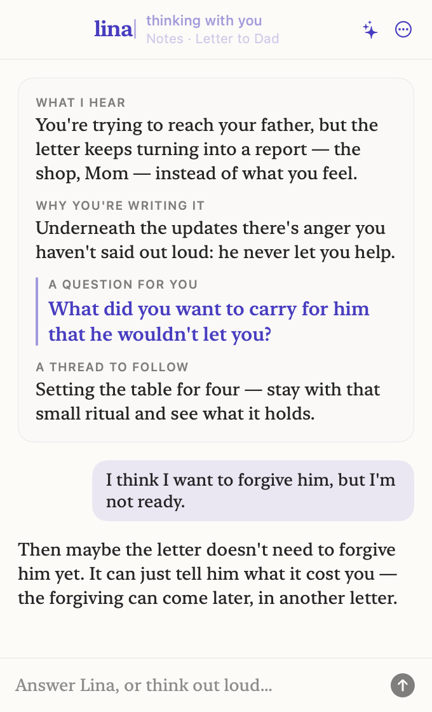
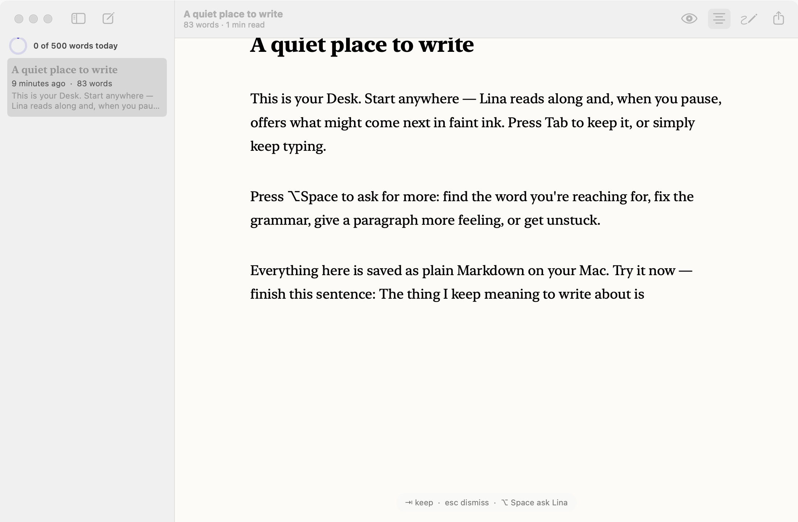
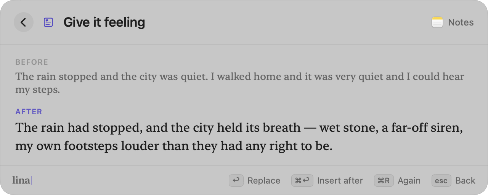
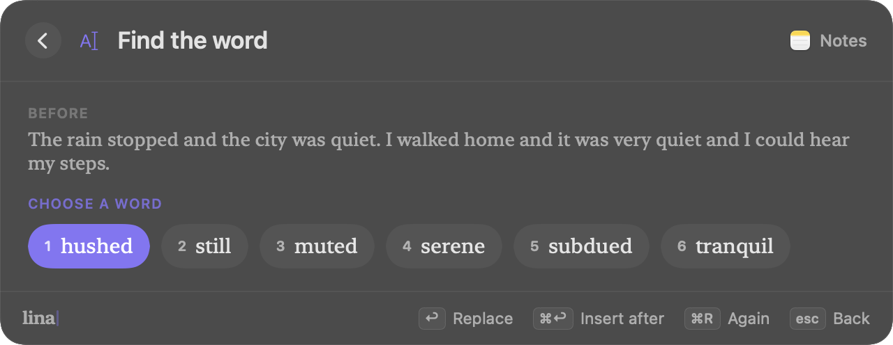

<p align="center"></p>

<h1 align="center">Lina</h1>
<p align="center"><strong>Write with someone beside you.</strong></p>

<p align="center">
  An open-source, private AI writing companion for macOS: it reads along in any app and thinks with you.
</p>

<p align="center">
  <a href="LICENSE"></a>
  
  
  
  
  
</p>

<p align="center">
  <a href="https://sppdd.github.io/lina/"><strong>Website</strong></a> ·
  <a href="https://github.com/Sppdd/lina/releases/latest/download/Lina.zip"><strong>Download for Mac</strong></a> ·
  <a href="#install">Install</a> ·
  <a href="#what-lina-does">Features</a> ·
  <a href="#how-it-works">How it works</a> ·
  <a href="#nebius--nvidia">Nebius × NVIDIA</a> ·
  <a href="#privacy">Privacy</a> ·
  <a href="#contributing">Contributing</a>
</p>

---

Most AI writing tools write *for* you. Lina writes *with* you.

Lina is a menu bar app that reads along in **any app**: Notes, Mail, Journal, Safari, Obsidian. When you pause, Lina writes in ink just above your cursor and thinks with you. It tells you what it hears you saying, why you seem to be writing it, one question that takes you deeper, and a thread worth following. In **Understand** mode **it never types into your document**: you answer its question (`⌥ Space` opens a reply box), and the conversation keeps going. Switch to **Edit** or **Auto** mode (`⇧⌥ Space`) and Lina rewrites each sentence you finish instead.

Under the hood, Lina runs **NVIDIA Nemotron on Nebius Token Factory**: Nemotron 3 Super for the companion, Nemotron 3 Nano for fast ghost text. It can also run fully on your own Mac with Ollama, LM Studio or llama.cpp, so nothing leaves your machine.

<p align="center"></p>

## Why Personal AI

Writing is how people think through the things that matter to them: a journal entry, a letter to a parent, a hard email, an essay they've been putting off. Lina is built for that personal writing:

- **It lives where you already write.** Lina works across every app you use and doesn't ask you to move into a new editor.
- **It's about you, not the output.** Lina asks questions and reflects your meaning back to you. It doesn't hand you paragraphs to paste.
- **It learns your voice.** Pick Journal, Essay, Research, Story or Work, and tell Lina a little about how you write.
- **It's yours.** There's no account and no analytics. Stats live on your Mac, and you can switch to a local model for complete privacy.

## What Lina does

New to Lina? **[How to use Lina](docs/USAGE.md)** walks through every feature with examples.

| Feature | |
|---|---|
| **Companion** | When you pause, Lina reads the whole draft and writes what it hears and one question for you in an ink card just above your cursor, in any app. There's no window to look away to. It steps aside as soon as you type or press `esc`. `⌥ Space` opens a reply box to talk it through. With the ink drop off, Lina uses a popup instead. |
| **`/lina` anywhere** | Type `/lina` and an instruction wherever you write, then press `↩`. "This" means the text before the command on its line, or else the paragraph above it. `/lina edit this paragraph` rewrites it in place, `/lina write a closing line` writes new text where the command was, `/lina turn this description to a photo` draws a picture and pastes it there, and `/lina remember this` saves it to memory. `⌘Z` undoes, and `esc` stops a command that's still running. |
| **Memory (`⌃⌥ M`)** | Highlight text in any app and press `⌃⌥ M`, or type `/lina remember …`. Lina keeps these notes on your Mac and uses them whenever it writes or thinks with you. You can review and delete them in **Settings → Memory**. |
| **Modes (`⇧⌥ Space`)** | Cycle like Claude Code's modes. **Understand** reads along and asks questions, and never edits. **Edit** offers a rewrite of each sentence you finish; `⇥` takes it, `esc` keeps yours. **Auto** rewrites each sentence you finish in place, and `⌘Z` undoes it. In Edit or Auto, `⌥ Space` rewrites the sentence at the cursor right away, even an unfinished one. |
| **Ink drop** | A drop of Lina's ink rides just above your text cursor in any app, and Lina's cards, rewrites and notes are written beside it. It breathes while it rests, swirls while Lina thinks and becomes a waveform while it listens. When Lina finds a thread worth following, the drop flies to those words in your draft and underlines them. **Show me where** in the popup does it again. |
| **Hold `⌃⌥` to talk** | Speak instead of typing. In Understand you answer Lina's question; in Edit and Auto you say how to rewrite the sentence at your cursor ("make it warmer"). Speech is recognized on your Mac when your language supports it. Lina can also read its questions aloud (off by default). |
| **Report a problem** | Hard to describe what went wrong? Type `/lina bug` and a few words right where it happened, or pick **Report a Problem…** in the menu bar. Lina writes a report from what it saw (your setup, the text field in front of you, and its recent decisions and errors), copies it, saves it to `~/Library/Logs/Lina/reports/latest.md` and sends it to the Lina team (you can switch that off). Reports never include your document's text. |
| **Ghost text** *(optional)* | A context-aware continuation appears at the caret in any app after a natural pause, never mid-word. `⇥` keeps it, `⌥⇥` keeps one word, `esc` or typing dismisses it. |
| **Rewrite palette** | A Spotlight-style palette with **Keep going**, **Find the word**, **Fix grammar**, **Say it clearer**, **Give it feeling**, **Tighten**, **I'm stuck**, **Look it up**, or any instruction you type. `↩` replaces, `⌘↩` inserts after. |
| **Use what I gathered** *(opt-in)* | Turn on **Settings → Memory → Keep what I copy and screenshot** and Lina keeps the quotes you copy and the screenshots you take while researching. It reads screenshots with Apple's on-device OCR. Then pick **Use what I gathered** in the palette and Lina writes the next lines from them. It keeps the last 30 in memory only, skips passwords, and forgets everything when it quits. |
| **Look it up, with a source** *(opt-in)* | With **Settings → Privacy → Look it up on Wikipedia** on, **Look it up** searches Wikipedia in your question's language, answers from those pages and shows the links. `⌘↩` inserts the answer with its citation. Only the question is sent, never your draft. |
| **Models on this Mac** | Pick **On this Mac** and Lina finds your Ollama server, recommends a model for your Mac's memory (Llama 3.2 or NVIDIA Nemotron Mini) and downloads it with progress, from onboarding or **Settings → Model**. You can switch and delete models there too. |
| **The Desk** | A calm serif writing space with inline ghost text, typewriter scrolling and a focus mode. Pages are plain Markdown files. |
| **Daily rhythm** | A word goal, a progress ring and a streak in the menu bar, all stored only on your Mac. |
| **Private by design** | Lina never reads password fields or secure input. You can turn it off per app, and the “On this Mac” mode keeps everything local. |

<p align="center">
  
</p>
<p align="center">
  
  
</p>

## Install

**Quickest:** download [Lina.zip](https://github.com/Sppdd/lina/releases/latest/download/Lina.zip), unzip it and drag **Lina.app** into Applications. Lina isn't notarized yet, so the first time macOS blocks it, open **System Settings → Privacy & Security** and click **Open Anyway** (or run `xattr -dr com.apple.quarantine /Applications/Lina.app`).

**From source.** Requirements: macOS 14+, Apple Silicon, Xcode 16+ command line tools.

```sh
git clone https://github.com/Sppdd/lina.git && cd lina
scripts/build-app.sh --open      # builds build/Lina.app and launches it
```

To keep Lina, move `build/Lina.app` to `/Applications`. On first launch, onboarding walks you through three steps:

1. **Accessibility access.** Lina needs it to read the field you're typing in and find your cursor (System Settings → Privacy & Security → Accessibility).
2. **A model.**
   - **Nebius Token Factory (default).** Paste an API key from [tokenfactory.nebius.com](https://tokenfactory.nebius.com). If you build from source, you can instead create a `.env` file at the repo root containing `NEBIUS_API_KEY=…`.
   - **On this Mac.** Run `ollama serve` and `ollama pull llama3.2` (or pull any other model), then point Lina at `http://localhost:11434/v1`.
3. **Your voice and daily goal.**

> `scripts/build-app.sh` signs Lina with a requirement pinned to its bundle ID, so the Accessibility permission survives rebuilds. If Lina still says access is missing, click **Grant Access** in the menu bar or in Settings.

### Check a model from the terminal

```sh
swift build
NEBIUS_API_KEY=… .build/debug/Lina --selftest            # Nebius / Nemotron
.build/debug/Lina --selftest --companion                 # one companion reflection
.build/debug/Lina --selftest --local llama3.2            # local Ollama model
.build/debug/Lina --selftest --models                    # list models on your endpoint
```

## Nebius × NVIDIA

| | Model | Role |
|---|---|---|
| Companion | [`nvidia/nemotron-3-super-120b-a12b`](https://tokenfactory.nebius.com) | Reads the full draft and returns a structured reflection (what, why, question, thread), then carries the conversation. |
| Ghost text & palette | `nvidia/NVIDIA-Nemotron-3-Nano-30B-A3B` | Low-latency continuations and rewrites at the caret. |
| Pictures | `black-forest-labs/flux-schnell` | `/lina … photo`: the companion model turns your words into an image prompt, then Token Factory's `/images/generations` draws it with the same API key. |

Lina talks to Nebius Token Factory through its OpenAI-compatible `/chat/completions` endpoint and streams every response. Nemotron's reasoning mode is turned off (`/no_think`, `enable_thinking: false`), and any `<think>` spans are filtered out of the stream, so text appears as fast as you pause. You can switch models from **Settings → Model**.

## How it works

```
 Any app (Notes, Mail, Safari, …)
        │  AXUIElement: text, selection, caret bounds
        ▼
 ┌─────────────┐   pause + finished word   ┌──────────────────────┐
 │ Input tap   │ ────────────────────────▶ │ Companion / Ghost    │
 │ (CGEventTap)│                           │ engines              │
 └─────────────┘                           └──────────┬───────────┘
                                                      │ streaming
                                                      ▼
                                     Nebius Token Factory (Nemotron)
                                       or a local OpenAI-compatible model
                                                      │
        ┌─────────────────────────────────────────────┘
        ▼
 Floating, non-activating NSPanels: companion window · ghost text · palette
```

```
Sources/Lina
├── App/      LinaApp (menu bar + windows), self-test, live test, snapshot renderer
├── Core/     Accessibility reader, event tap & text insertion, hotkey,
│             streaming OpenAI-compatible client, prompts, settings, keychain, stats
├── Engine/   Companion, GhostEngine, PaletteController, targets
├── Desk/     DeskTextView (inline ghost, typewriter, focus), page store
├── UI/       Companion popup, ghost panel, palette, menu bar, settings, onboarding
└── Design/   Theme: ink, paper, New York serif, keycaps
```

- **Reading.** `AXUIElement` provides the focused field's text, selection and caret bounds. Lina skips secure fields, secure input and apps you've turned it off for.
- **Timing.** A `CGEventTap` watches keystrokes and swallows Tab and Esc **only** while a suggestion is on screen. Lina waits for your pause (550 ms by default) after a finished word or comma before it asks the model, and typing cancels any request in flight.
- **Showing.** Click-through, non-activating `NSPanel`s follow the caret. Accepted text is typed in as keyboard events, so it lands in the host app's own undo stack. Palette rewrites are pasted in, and your clipboard is restored afterwards.

## Inspired by Clicky

The ink drop, pointing and hold-to-talk are adapted from [Clicky](https://github.com/farzaa/clicky) (MIT), Farza's AI buddy that lives next to your mouse cursor. Lina's version follows the **text caret** instead of the mouse, points at **phrases in your draft** instead of buttons on screen, and keeps speech on your Mac with no screenshots or analytics. See [docs/research/clicky-synthesis.md](docs/research/clicky-synthesis.md) for what we took from it and why.

## Privacy

- Lina never reads password fields or secure input, and you can turn it off per app.
- There's no account, telemetry or analytics. The only thing Lina sends to its own server is a problem report you create yourself (Supabase, insert-only: no one can read reports back through the app's key). You can switch that off in **Settings → General → Problem reports**.
- Your API key is stored in `~/Library/Application Support/Lina/secrets.json`, which only your user account can read (mode 0600). Lina doesn't use the Keychain: an ad-hoc-signed build would set off a Keychain permission prompt after every rebuild.
- Text goes only to the endpoint you choose. With **On this Mac**, nothing leaves your machine, except a `/lina … photo` request, which always goes to Token Factory.
- Lina keeps a log of its own decisions in `~/Library/Logs/Lina/lina.log` to help explain problems. It records app names, lengths and errors, never what you write.
- Memory lives in `~/Library/Application Support/Lina/memory.json` (mode 0600). Pictures are saved to `~/Pictures/Lina`.

## Develop

```sh
swift test                                        # unit tests
.build/debug/Lina --snapshots build/snapshots     # render every screen, light + dark
```

The Supabase project (problem reports) lives in `cloud/supabase`. Run the CLI from `cloud/` so it doesn't read the app's `.env`:

```sh
cd cloud && supabase db push                      # apply migrations to the linked project
```

## Roadmap

- Signed, notarized release builds
- Memory of past sessions, kept on-device, so the companion can follow a theme across days
- Voice reflections
- Intel Mac support

## Contributing

Issues and pull requests are welcome. Before you open a PR:

1. Run `swift build` and `swift test`.
2. For UI changes, render snapshots with `--snapshots` and attach the relevant screenshots.
3. Keep Lina's promise: it never writes into the user's document without an explicit keystroke, and it never sends text anywhere the user didn't choose.

## Hackathon

Lina is built for the **Nebius × NVIDIA Global AI Hackathon**, in the **Personal AI** track. It runs on Nebius Token Factory and uses NVIDIA's open Nemotron models. The whole project was built during the submission window.

## License

[MIT](LICENSE) © 2026 Karrar Abudhar
