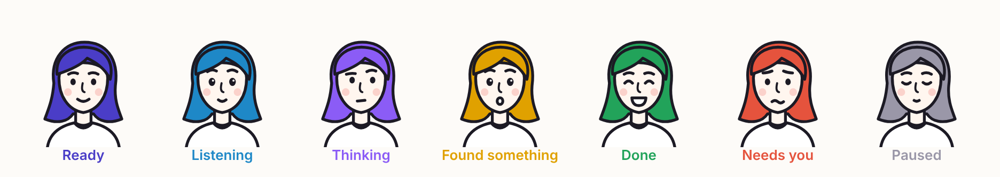

<p align="center"></p>

<h1 align="center">Lina</h1>
<p align="center"><strong>Write with someone beside you.</strong></p>

<p align="center">
  An open-source writing helper for macOS. Lina lives at your cursor in every app and speaks only when you ask.
</p>

<p align="center">
  <a href="LICENSE"></a>
  
  
  
  
  
</p>

<p align="center">
  <a href="#install">Install</a> ·
  <a href="#what-lina-does">Commands</a> ·
  <a href="#how-it-works">How it works</a> ·
  <a href="#nebius--nvidia">Nebius × NVIDIA</a> ·
  <a href="#privacy">Privacy</a> ·
  <a href="#contributing">Contributing</a>
</p>

---

Most AI writing tools interrupt you. Lina waits.

Type `/lina` and what you want right in your text, in **any field of any app** (Notes, Mail, Slack, a browser's search box). Lina tints and underlines the command so it reads as hers, not yours. Press Return and she gets to work; Return never reaches the app, so a search box won't submit. The answer waits in a card under your line: a fact from the web worded to fit your sentence, a question that makes you think, three rewrites, or a picture. **Nothing goes into your text until you press ⌘1, ⌘2 or ⌘3**, and then the answer takes the command's place, so there's nothing to delete. Esc takes the command back out and leaves your words exactly as they were.

When you pause after finishing a sentence, Lina quietly checks it. If something's wrong, a small chip with the right word appears **right above each mistake**: ⌘1, ⌘2… fixes one, ⌘A fixes them all. If nothing's wrong, you never notice her. You choose how long she waits after you stop typing.

<p align="center"></p>

Lina is a character. Her hair color and face tell you what she's doing, in the menu bar and on every card: violet when ready, blue while you type `/lina`, lavender while she thinks, amber when a card is waiting, green when your choice went in, red when she needs you, grey when paused.

Under the hood: **NVIDIA Nemotron on Nebius Token Factory** for checks and commands, **FLUX** on Token Factory for pictures, and **Google Gemini with Search grounding** for live answers. Commands can also run on a model on your own Mac.

## What Lina does

| Do this | Lina does this |
|---|---|
| Finish a sentence and pause | Checks it. The right word appears above each mistake; ⌘1, ⌘2… fixes one, ⌘A fixes all. |
| `The final ended /lina who won and how` ↩ | Searches the web. ⌘1 swaps the command for an answer that fits: *"…ended with Argentina beating France on penalties"*. ⌘2 adds the source. |
| `/lina` ↩ (nothing else) | One short question about what you just wrote. |
| `/lina fix` ↩ | Checks the whole paragraph. |
| `/lina rewrite polite` ↩ | Three rewrites of the paragraph in that tone; pick with ⌘1–⌘3. |
| `/lina edit make it shorter` ↩ | The paragraph, changed the way you asked. |
| `/lina model` ↩ | Every writing and image model available; switch with ⌘1–⌘9. |
| `/lina image a reading nook at dusk` ↩ | A picture; ⌘1 puts it where the command was. |
| `/lina saved` / `/lina help` ↩ | Opens Saved / lists the commands. |
| `⌥ Space` | Types `/lina ` for you, ready for what you want. |

A pause after `,` `.` or `!` also runs a command, so you can keep the rhythm of a sentence. Commands that only talk to Lina (`/lina`, `model`, `help`, `saved`) take themselves out of your text as they run. Fields Lina can't read (some web search boxes) still work: she follows your keystrokes and puts the answer where the command was.

The first time you use each part, a small tip appears under your own text with a `^` pointing at it.

**Lina's window** (click the menu bar face → Open Lina) has animated demos of six use cases, everything she has saved (searches with sources, questions, rewrites, pictures), and the models behind her. The full design is in [docs/REDESIGN.md](docs/REDESIGN.md).

## Install

**Requirements:** macOS 14+, Apple Silicon, Xcode 16+ command line tools.

```sh
git clone https://github.com/Sppdd/lina.git && cd lina
scripts/build-app.sh --open      # builds build/Lina.app and launches it
```

On first launch, onboarding walks you through:

1. **Accessibility access**, so Lina can read the line you're typing when you ask (System Settings → Privacy & Security → Accessibility).
2. **Sign in, or keys.** When the build is connected to a Lina server (Supabase), you sign in with an emailed code and need no keys. For development without a server, paste keys in onboarding or Settings, or put them in a `.env` file at the repo root:
   ```sh
   NEBIUS_API_KEY=…    # tokenfactory.nebius.com: checks, commands, /lina model, /lina image
   GEMINI_API_KEY=…    # aistudio.google.com/apikey: live web answers (optional)
   ```
   This is the developer setup. In the released app, people sign up instead and the keys stay on Lina's server; see [docs/PRODUCTION.md](docs/PRODUCTION.md).
   To keep commands on your Mac, choose **On this Mac** and run `ollama serve` with `ollama pull llama3.2`.
3. **A practice page.** Lina opens one in TextEdit with things to try.

> `scripts/build-app.sh` signs Lina with a requirement pinned to its bundle ID, so the Accessibility permission survives rebuilds. If Lina still says access is missing, click **Grant Access** in the menu bar or in Settings.

### Check the models from the terminal

```sh
swift build
.build/debug/Lina --selftest                               # sentence check, /lina question, rewrites
.build/debug/Lina --selftest --search "who won the 2022 World Cup"
.build/debug/Lina --selftest --models                      # writing and image models on Token Factory
.build/debug/Lina --selftest --image "a red fox in snow" fox.png
.build/debug/Lina --selftest --local llama3.2              # a local Ollama model
```

## Nebius × NVIDIA

| | Model | Role |
|---|---|---|
| Commands | [`nvidia/nemotron-3-super-120b-a12b`](https://tokenfactory.nebius.com) | `/lina` questions, rewrites, edits. Switch with `/lina model`. |
| Sentence checks | `nvidia/NVIDIA-Nemotron-3-Nano-30B-A3B` | Fast proofreading of each finished sentence, as JSON. |
| Pictures | `black-forest-labs/flux-schnell` | `/lina image`. |
| Web answers | Google Gemini Flash-Lite + Search grounding | Questions after `/lina`, with sources and Google's search suggestions. |

Lina talks to Token Factory through its OpenAI-compatible endpoints (`/chat/completions`, `/images/generations`, `/models`). Nemotron's reasoning mode is turned off (`/no_think`, `enable_thinking: false`) and any `<think>` spans are filtered out, so answers come back fast.

## How it works

```
 Any app (Notes, Mail, Safari, …)
        │  keystrokes (CGEventTap): "/lina …" is marked in place, Return runs it; a pause after a sentence starts a check
        ▼
 ┌──────────────┐  reads the field (AXUIElement)  ┌──────────────────────────────┐
 │ LinaEngine   │ ──────────────────────────────▶ │ Nemotron · FLUX · Gemini     │
 └──────┬───────┘                                 └──────────────────────────────┘
        │  fix chips above mistakes, cards under the line (non-activating NSPanels), ^ tips
        ▼
 ⌘1 / ⌘2 / ⌘3  →  selects the exact range via Accessibility and pastes; your clipboard is restored
```

```
Sources/Lina
├── App/      LinaApp (menu bar face, windows), self-test, live test, snapshot renderer
├── Core/     Commands (parser, sentences, proofread JSON), prompts, Token Factory + Gemini clients,
│             Accessibility reader, event tap and text insertion, settings, secrets, account, history
├── Engine/   LinaEngine, Writer (puts choices into the text), tips
├── UI/       Cards, command mark, fix chips, menu bar, Lina's window, demos, onboarding, settings
└── Design/   Lina's face and moods, theme
```

## Privacy

- Lina reads only when you type `/lina` or finish a sentence, never password fields or secure input, and you can pause her per app.
- What's sent: the finished sentence for checks; the paragraph for commands; the question and nearby words to Gemini for search; only the description for pictures. Settings → Privacy spells it out.
- No telemetry or analytics. Signed in, requests go through Lina's server (`supabase/functions/lina-ai`), which holds the provider keys and keeps only daily counts, never your text. Development keys are kept in a file only your user can read. Saved items are a JSON file on your Mac.

## Develop

```sh
swift test                                        # unit tests
.build/debug/Lina --snapshots build/snapshots     # render every screen and card, light + dark
.build/debug/Lina --livetest                      # drive TextEdit end to end
```

## Roadmap

- Skills and plug-ins: `/lina cite`, `/lina translate`, a team style guide, Notion and Google Docs search
- A hand-drawn illustration set for Lina
- Signed, notarized release builds
- Intel Mac support

## Contributing

Issues and pull requests are welcome. Before you open a PR:

1. Run `swift build` and `swift test`.
2. For UI changes, render snapshots with `--snapshots` and attach the relevant screenshots.
3. Keep Lina's promise: she speaks only when asked, never writes into the user's text without a ⌘ keystroke, and never sends text anywhere the user didn't choose.

## Hackathon

Lina is built for the **Nebius × NVIDIA Global AI Hackathon**, in the **Personal AI** track. It runs on Nebius Token Factory and uses NVIDIA's open Nemotron models. The whole project was built during the submission window.

## License

[MIT](LICENSE) © 2026 Karrar Abudhar
